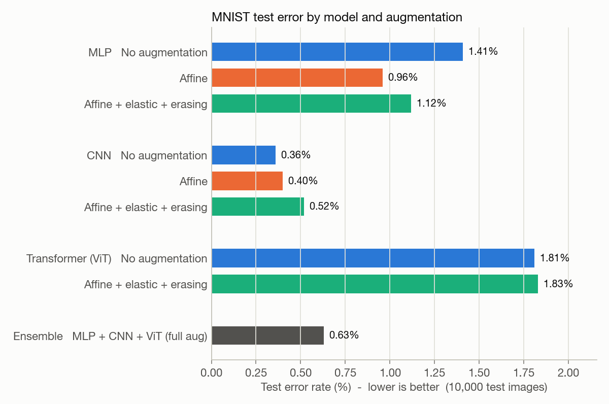
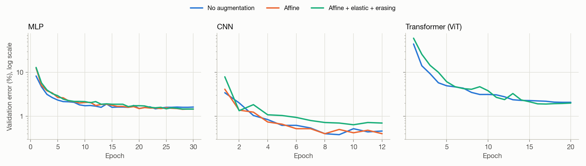
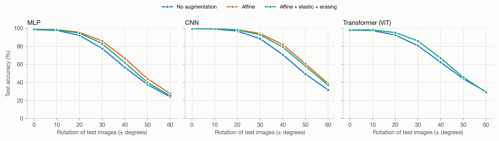
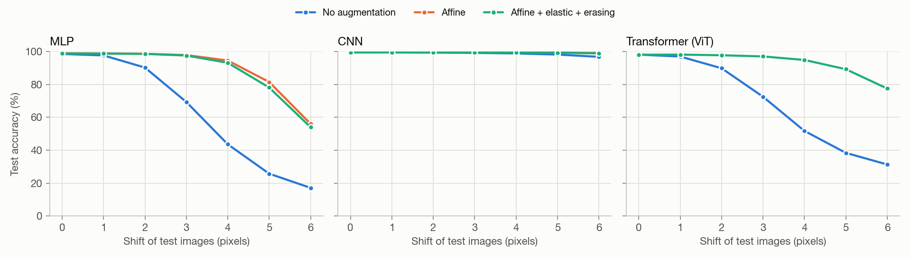

# MNIST test results

Every model is trained on 55,000 images from the official **train** split; the checkpoint is
chosen on the remaining 5,000 train images (validation). The official **test** split
(10,000 images) is used only by `src/test.py`, once per final checkpoint.

| Run | Model | Augmentation | Params | Epochs (best) | Train time | Val acc % | **Test acc %** | Test errors | Rotated ±30° acc % | Shifted 4 px acc % |
|---|---|---|--:|--:|--:|--:|--:|--:|--:|--:|
| `mlp_none` | MLP | No augmentation | 407,050 | 30 (23) | 1.0 min | 98.52 | **98.59** | 141 | 77.75 | 43.64 |
| `mlp_affine` | MLP | Affine | 407,050 | 30 (28) | 1.5 min | 98.56 | **99.04** | 96 | 85.94 | 94.61 |
| `mlp_full` | MLP | Affine + elastic + erasing | 407,050 | 30 (30) | 2.6 min | 98.54 | **98.88** | 112 | 83.07 | 93.22 |
| `cnn_none` | CNN | No augmentation | 140,458 | 12 (9) | 15.7 min | 99.62 | **99.64** | 36 | 88.53 | 98.92 |
| `cnn_affine` | CNN | Affine | 140,458 | 12 (12) | 14.2 min | 99.60 | **99.60** | 40 | 94.30 | 99.57 |
| `cnn_full` | CNN | Affine + elastic + erasing | 140,458 | 12 (10) | 14.0 min | 99.36 | **99.48** | 52 | 92.81 | 99.43 |
| `vit_none` | Transformer (ViT) | No augmentation | 139,018 | 20 (20) | 26.5 min | 97.92 | **98.19** | 181 | 80.73 | 51.78 |
| `vit_full` | Transformer (ViT) | Affine + elastic + erasing | 139,018 | 20 (17) | 33.1 min | 98.10 | **98.17** | 183 | 86.02 | 94.95 |
| `ensemble` | MLP + CNN + ViT | each with full augmentation | - | - | - | - | **99.37** | 63 | - | - |

## Are the differences real? (exact McNemar test on the same 10,000 test images)

| Comparison (A vs B) | Errors A → B | Only A correct | Only B correct | p-value | at α = 0.05 |
|---|--:|--:|--:|--:|--:|
| `mlp_none` vs `mlp_affine` | 141 → 96 | 25 | 70 | 4.27e-06 | significant |
| `mlp_none` vs `mlp_full` | 141 → 112 | 38 | 67 | 0.00602 | significant |
| `cnn_none` vs `cnn_affine` | 36 → 40 | 18 | 14 | 0.597 | not significant |
| `cnn_none` vs `cnn_full` | 36 → 52 | 30 | 14 | 0.0226 | significant |
| `vit_none` vs `vit_full` | 181 → 183 | 118 | 116 | 0.948 | not significant |
| `mlp_full` vs `cnn_full` | 112 → 52 | 25 | 85 | 7.83e-09 | significant |
| `cnn_full` vs `vit_full` | 52 → 183 | 154 | 23 | 5.37e-25 | significant |
| `mlp_full` vs `vit_full` | 112 → 183 | 134 | 63 | 4.65e-07 | significant |
| `cnn_full` vs `ensemble` | 52 → 63 | 30 | 19 | 0.152 | not significant |

## Figures

